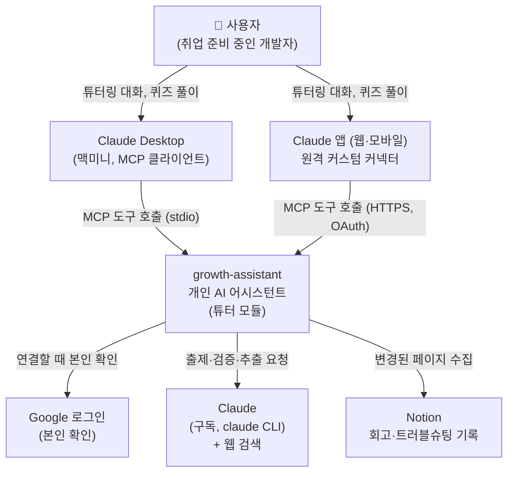

# C4 레벨 1: 시스템 컨텍스트

growth-assistant와 사용자, 외부 시스템의 관계.

| 요소 | 역할 |
|---|---|
| 사용자 | 유일한 사용자. 맥미니의 Claude Desktop으로 상호작용한다 (ADR-0018) |
| Claude Desktop | 인터페이스. 대화는 Claude 앱의 모델이 하고, growth-assistant는 MCP 도구(학습 맥락 조회, 학습 기록, 이후 복습·채점)를 제공한다 |
| Claude | Claude 앱은 대화를, `claude` CLI는 대화 밖 작업(출제·검증·경험 추출)을 맡는다. 상태는 없다 |
| Notion | 과거 경험의 유일한 원천. 읽기만 한다 (ADR-0023) |
| Claude 앱 (원격 커스텀 커넥터) | 모바일·아이패드·웹에서 같은 도구를 쓴다. Anthropic 서버가 공개 주소의 `/mcp`를 OAuth 토큰으로 부른다 (ADR-0035, 4단계) |
| Google 로그인 | 커넥터를 연결할 때 본인인지 확인한다(OIDC, 허용 이메일). 구글 토큰은 쓰지 않고 버린다 (ADR-0035) |
