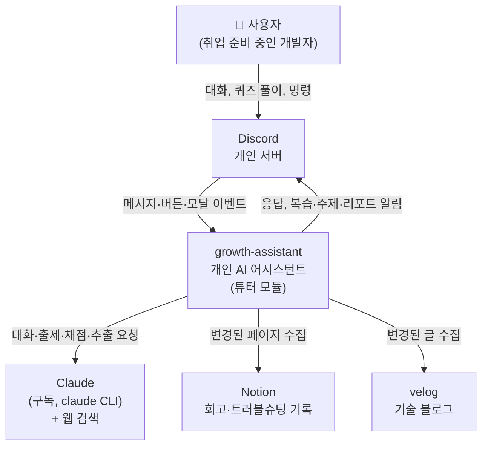

# C4 레벨 1: 시스템 컨텍스트

growth-assistant와 사용자, 외부 시스템의 관계.

| 요소 | 역할 |
|---|---|
| 사용자 | 유일한 사용자. Discord로만 상호작용한다 |
| Discord | 인터페이스. 슬래시 명령, 버튼, 모달, 스레드를 제공한다 |
| Claude | 생성과 판단(대화, 출제, 서술형 채점, 경험 추출)을 맡는다. 상태는 없다 |
| Notion, velog | 과거 경험의 원천. 읽기만 한다 |
