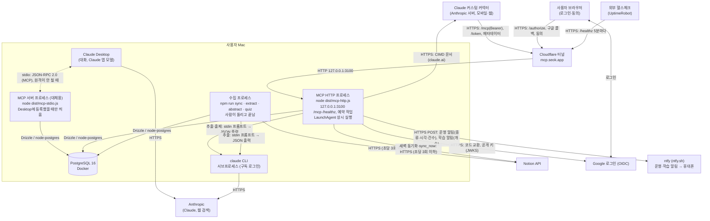

# C4 레벨 2: 컨테이너

사용자의 Mac 한 대에서 실행되는 구성 요소.

| 컨테이너 | 기술 | 책임 |
|---|---|---|
| MCP 서버 프로세스 | 같은 NestJS 코드, 진입점 `mcp-stdio.ts`, MCP TypeScript SDK v2 | Claude Desktop에 로컬로 붙일 때의 도구 호출을 받는다. 2026-10-20부터 Desktop도 원격 커넥터를 써서 등록을 뺐고, 원격이 안 될 때 대신 쓴다. 시작할 때 마이그레이션하지 않는다 (ADR-0018) |
| MCP HTTP 프로세스 | 같은 NestJS 코드·도구, 진입점 `mcp-http.ts`, Nest HTTP 앱(Express 어댑터, ADR-0035), Streamable HTTP | 원격 커스텀 커넥터(4단계)의 바탕. `/mcp`는 요청마다 새 MCP 서버로 답하고(세션 상태 없음) Host·Origin이 localhost나 공개 호스트(`PUBLIC_BASE_URL`)인 요청만 받으며, OAuth 액세스 토큰이 없으면 `401`이다. 같은 프로세스가 OAuth 인가 서버(메타데이터, `/authorize`, 구글 콜백·동의 화면, `/token`)를 겸한다. `/healthz`는 DB에 쿼리가 닿는지 답한다(외부 헬스체크용). 운영 알림(토큰 재사용, 허용 안 된 로그인, Claude CLI 인증 오류, 예약 작업 실패)은 `NTFY_TOPIC`이 있으면 ntfy로 보낸다(같은 종류 1시간에 한 번, 자세한 내용은 로그에만). 127.0.0.1에만 바인드하고 바깥에서는 Cloudflare 터널(`mcp.seok.app`)로 닿는다. 배포 릴리스에서 LaunchAgent(`com.growthassistant.server`)가 상시 실행한다. 상시 실행 프로세스라 서버 예약 작업도 맡는다(5단계, ADR-0036): 04:00 새벽 준비(Notion 동기화 → 경험 카드 추출 → 오늘 계획한 개념 20개의 문제 미리 만들기. 판단 사례 추상화는 하지 않음, ADR-0038·0040), 07:30 아침·21:00 저녁 학습 알림(ntfy). 스케줄러는 같은 이벤트 루프에서 돌고, 작업마다 마지막 실행을 DB에 남겨 놓친 실행을 그날 안에 한 번 따라잡는다. 예약 작업 실패도 운영 알림으로 보낸다 |
| 수집 프로세스 | 같은 NestJS 코드, 진입점 `sync.ts`·`extract.ts`·`abstract.ts`·`quiz.ts` | 사람이 손으로 돌리고 끝나는 CLI. Notion 문서를 한 번 동기화하고(처음은 백필), 경험 카드를 뽑고(문서마다 `claude -p` 한 번), 판단 사례를 만들고, 문제를 만들어 본다. 매일 동기화·추출은 MCP HTTP 프로세스의 새벽 작업이 같은 서비스로 한다(판단 사례는 이 CLI로만, ADR-0038) |
| PostgreSQL | PostgreSQL 16, drizzle-kit 마이그레이션 | 유일한 상태 저장소 (개념 그래프, 경험, 숙련도, 퀴즈, 학습 기록, 로그). 마이그레이션과 시드 개념 적재(`dist/seed.js`)는 배포할 때 한다 |
| claude CLI | `claude -p` | LLM 호출. 호출마다 새 프로세스, 전용 빈 작업 디렉터리, 기본 도구 비활성 |

## 운영 제약

- stdio MCP 서버는 Desktop에 등록했을 때 배포된 릴리스(`~/.growth-assistant/app/current`)에서 뜬다(지금은 등록하지 않음). 배포·로그는 [운영 가이드](../ops.md).
- MCP HTTP 프로세스는 launchd 사용자 에이전트로 상시 실행한다(`ops/install.sh`). 로그인해야 시작되고(FileVault), 죽으면 다시 띄우고, 배포하면 새 릴리스로 다시 띄운다. 시작할 때 놓친 예약 작업을 따라잡으려고 DB(OrbStack)를 1분까지 기다리고, 그래도 닿지 않으면 끝나서 launchd가 다시 띄운다.
- 예약 작업은 서버와 같은 이벤트 루프에서 돈다. 지금 작업은 대부분 I/O와 `claude -p` 서브프로세스라 `/mcp` 응답을 막지 않는다.
- Mac이 잠자기 상태이거나 서버가 꺼져 있으면 예약 작업이 실행되지 않는다. 그날 안에 서버가 뜨면 놓친 실행을 한 번 따라잡고, 날이 바뀌면 건너뛴다.
- `claude -p` 동시 실행은 최대 5개로 제한한다(ADR-0027).
- 구독 사용량 한도를 Claude Code 작업과 공유한다.
