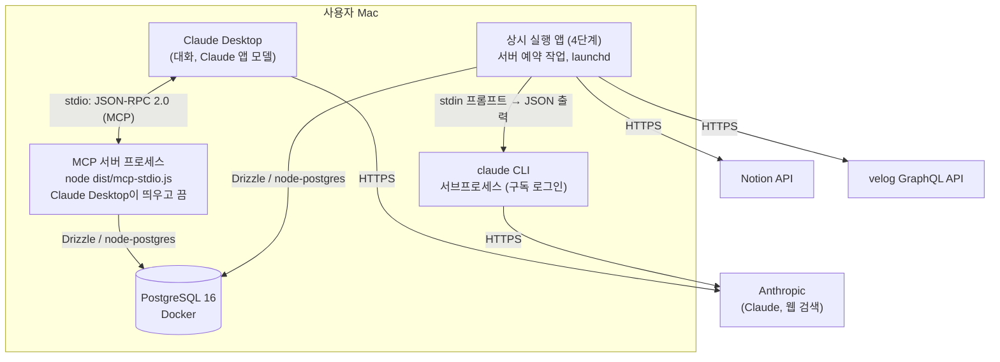

# C4 레벨 2: 컨테이너

사용자의 Mac 한 대에서 실행되는 구성 요소.

| 컨테이너 | 기술 | 책임 |
|---|---|---|
| MCP 서버 프로세스 | 같은 NestJS 코드, 진입점 `mcp-stdio.ts`, MCP TypeScript SDK v2 | Claude Desktop의 도구 호출을 받아 유스케이스 실행. 시작할 때 마이그레이션하지 않는다 (ADR-0018) |
| 상시 실행 앱 (4단계) | 같은 NestJS 코드, launchd | 동기화·문제 풀 보충 같은 서버 예약 작업. 아직 없다(Discord 봇과 함께 1단계에서 지웠다) |
| PostgreSQL | PostgreSQL 16, drizzle-kit 마이그레이션 | 유일한 상태 저장소 (개념 그래프, 경험, 숙련도, 퀴즈, 학습 기록, 로그). 마이그레이션은 배포할 때 적용한다 |
| claude CLI | `claude -p` | LLM 호출. 호출마다 새 프로세스, 전용 빈 작업 디렉터리, 기본 도구 비활성 |

## 운영 제약

- MCP 서버는 Claude Desktop이 배포된 릴리스(`~/.growth-assistant/app/current`)에서 띄운다. 배포·로그는 [운영 가이드](../ops.md).
- 상시 실행 앱을 만들면(4단계) launchd 사용자 에이전트로 실행한다. 로그인해야 시작되고(FileVault), 죽으면 다시 띄운다.

- Mac이 잠자기 상태이면 예약 작업이 실행되지 않는다. 깨어날 때 놓친 실행을 복구한다.
- `claude -p` 동시 실행은 최대 2개로 제한한다.
- 구독 사용량 한도를 Claude Code 작업과 공유한다.
