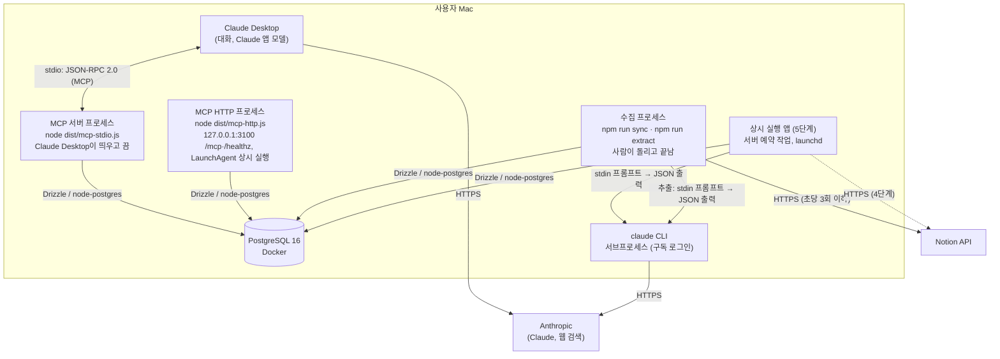

# C4 레벨 2: 컨테이너

사용자의 Mac 한 대에서 실행되는 구성 요소.

| 컨테이너 | 기술 | 책임 |
|---|---|---|
| MCP 서버 프로세스 | 같은 NestJS 코드, 진입점 `mcp-stdio.ts`, MCP TypeScript SDK v2 | Claude Desktop의 도구 호출을 받아 유스케이스 실행. 시작할 때 마이그레이션하지 않는다 (ADR-0018) |
| MCP HTTP 프로세스 | 같은 NestJS 코드·도구, 진입점 `mcp-http.ts`, Nest HTTP 앱(Express 어댑터, ADR-0035), Streamable HTTP | 원격 커스텀 커넥터(4단계)의 바탕. `/mcp`는 요청마다 새 MCP 서버로 답하고(세션 상태 없음) Host·Origin이 localhost인 요청만 받는다. `/healthz`는 DB에 쿼리가 닿는지 답한다(외부 헬스체크용). 기본은 127.0.0.1에만 바인드한다. 배포 릴리스에서 LaunchAgent(`com.growthassistant.server`)가 상시 실행한다. 인증·공개 경로는 아직 없다 |
| 수집 프로세스 | 같은 NestJS 코드, 진입점 `sync.ts`·`extract.ts` | Notion 문서를 한 번 동기화하고 끝낸다(처음은 백필). 동기화한 문서에서 경험 카드를 뽑는다(문서마다 `claude -p` 한 번). 매일 실행은 4단계에서 상시 실행 앱으로 옮긴다 |
| 상시 실행 앱 (5단계) | 같은 NestJS 코드, launchd | 동기화·문제 풀 보충 같은 서버 예약 작업. 아직 없다. 원격 MCP 서버는 위 MCP HTTP 프로세스가 상시 실행하고, 예약 작업을 그 프로세스에 둘지는 5단계에서 정한다 |
| PostgreSQL | PostgreSQL 16, drizzle-kit 마이그레이션 | 유일한 상태 저장소 (개념 그래프, 경험, 숙련도, 퀴즈, 학습 기록, 로그). 마이그레이션과 시드 개념 적재(`dist/seed.js`)는 배포할 때 한다 |
| claude CLI | `claude -p` | LLM 호출. 호출마다 새 프로세스, 전용 빈 작업 디렉터리, 기본 도구 비활성 |

## 운영 제약

- MCP 서버는 Claude Desktop이 배포된 릴리스(`~/.growth-assistant/app/current`)에서 띄운다. 배포·로그는 [운영 가이드](../ops.md).
- MCP HTTP 프로세스는 launchd 사용자 에이전트로 상시 실행한다(`ops/install.sh`). 로그인해야 시작되고(FileVault), 죽으면 다시 띄우고, 배포하면 새 릴리스로 다시 띄운다. 시작할 때 DB에 연결하지 않으므로 DB(OrbStack)보다 먼저 떠도 되고, DB가 뜨기 전 요청은 연결 오류로 실패한다.

- Mac이 잠자기 상태이면 예약 작업이 실행되지 않는다. 깨어날 때 놓친 실행을 복구한다.
- `claude -p` 동시 실행은 최대 5개로 제한한다(ADR-0027).
- 구독 사용량 한도를 Claude Code 작업과 공유한다.
