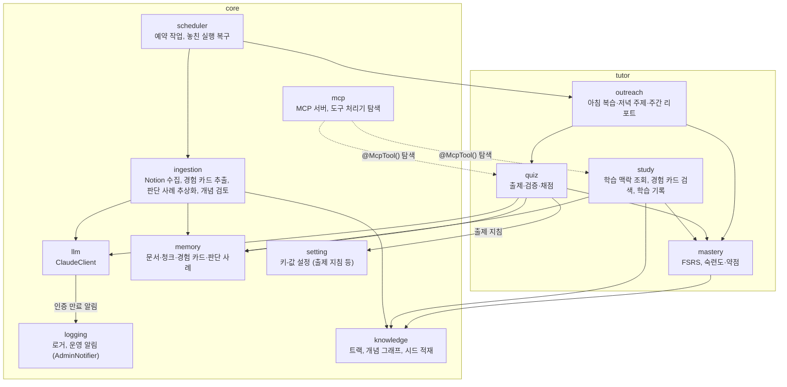

# C4 레벨 3: 컴포넌트 (NestJS 애플리케이션)

`core`는 여러 기능 모듈이 공유하는 기반이고, `tutor`는 첫 기능 모듈이다. 이후 `career` 모듈(이력서·포트폴리오)이 `core`를 공유하며 추가될 예정이다.

## 의존 규칙

- `tutor` → `core` 방향으로만 의존한다. `core`는 `tutor`를 모른다.
- `tutor` 하위 모듈끼리는 화살표 방향으로만 의존한다. 순환 의존을 만들지 않는다.
- 유스케이스는 MCP SDK 객체를 받지 않는다. 도구 처리기가 zod로 검증된 값을 넘기고, 결과를 요약 텍스트와 구조화된 내용으로 돌려준다.
- `core/mcp`는 `@McpTool()`이 붙은 provider를 `DiscoveryService`로 모아 등록한다(점선: 의존이 아니라 탐색). 기능 모듈은 `core/mcp`를 import하지 않는다.
- 외부 시스템과 닿는 경계만 포트·어댑터로 분리한다 ([ADR-0015](../adr/0015-nest-feature-modules.md)). 유스케이스는 `ClaudeClient`·`AdminNotifier`·`DocumentSource`(Notion 어댑터) 같은 포트에만 의존하고, 기능 모듈의 MCP 도구 처리기는 그 모듈의 `mcp/` 폴더에 둔다. `quiz` 모듈만 모듈 안을 레이어 폴더로 나누고 폴더별 린트로 의존 방향을 강제한다 ([ADR-0020](../adr/0020-quiz-layered-folders.md)).
- 도메인 규칙은 순수 함수로 두고, 저장소는 기능 모듈 안에서 Drizzle을 직접 써서 행과 도메인 타입을 변환한다.
- `core`가 `tutor`를 가져오지 못하게 ESLint `no-restricted-imports`로 막는다.
- 숙련도·약점 점수와 복습 일정은 `mastery`의 코드가 결정적으로 계산한다. `llm`은 생성과 채점만 한다.
