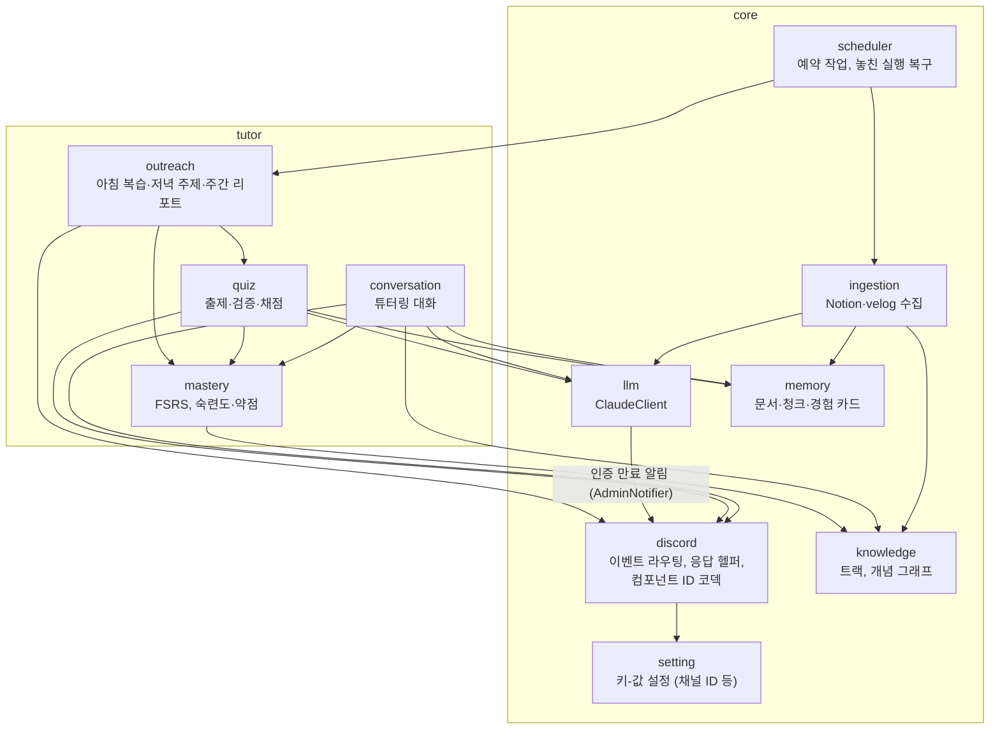

# C4 레벨 3: 컴포넌트 (NestJS 애플리케이션)

`core`는 여러 기능 모듈이 공유하는 기반이고, `tutor`는 첫 기능 모듈이다. 이후 `career` 모듈(이력서·포트폴리오)이 `core`를 공유하며 추가될 예정이다.

## 의존 규칙

- `tutor` → `core` 방향으로만 의존한다. `core`는 `tutor`를 모른다.
- `tutor` 하위 모듈끼리는 화살표 방향으로만 의존한다. 순환 의존을 만들지 않는다.
- 유스케이스는 discord.js 객체를 받지 않는다. `discord`가 값으로 바꿔 넘긴다.
- 외부 시스템과 닿는 경계만 포트·어댑터로 분리한다 ([ADR-0015](../adr/0015-nest-feature-modules.md)). 유스케이스는 `ClaudeClient` 같은 포트에만 의존하고, 기능 모듈의 Discord 입력 어댑터는 그 모듈의 `discord/` 폴더에 둔다. `core/discord`는 처리기 데코레이터와 discord.js 클라이언트를 맡고, 게이트웨이가 데코레이터가 붙은 처리기를 찾아 등록한다.
- 도메인 규칙은 순수 함수로 두고, 저장소는 기능 모듈 안에서 Drizzle을 직접 써서 행과 도메인 타입을 변환한다.
- `core`가 `tutor`를 가져오지 못하게 ESLint `no-restricted-imports`로 막는다.
- 숙련도·약점 점수와 복습 일정은 `mastery`의 코드가 결정적으로 계산한다. `llm`은 생성과 채점만 한다.
