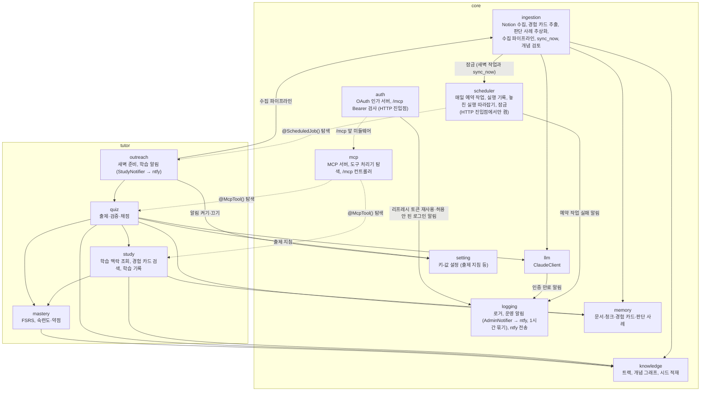

# C4 레벨 3: 컴포넌트 (NestJS 애플리케이션)

`core`는 여러 기능 모듈이 공유하는 기반이고, `tutor`는 첫 기능 모듈이다. 이후 `career` 모듈(이력서·포트폴리오)이 `core`를 공유하며 추가될 예정이다.

## 의존 규칙

- `tutor` → `core` 방향으로만 의존한다. `core`는 `tutor`를 모른다.
- `tutor` 하위 모듈끼리는 화살표 방향으로만 의존한다. 순환 의존을 만들지 않는다.
- 유스케이스는 MCP SDK 객체를 받지 않는다. 도구 처리기가 zod로 검증된 값을 넘기고, 결과를 요약 텍스트와 구조화된 내용으로 돌려준다.
- `core/mcp`는 `@McpTool()`이 붙은 provider를 `DiscoveryService`로 모아 등록한다(점선: 의존이 아니라 탐색). 기능 모듈은 `core/mcp`를 import하지 않는다. `McpServerHost`는 연결(stdio)이나 HTTP 요청마다 도구를 모두 단 새 SDK 서버를 만들고, HTTP 앱에서는 `McpHttpController`(`/mcp`)가 `createMcpHandler`로 Streamable HTTP를 받는다. 진입점은 전송만 고른다. 처리기가 화면(`view`: `ui://` 주소와 HTML)을 가지면 `@modelcontextprotocol/ext-apps`의 서버 도우미로 도구에 MCP Apps 메타데이터(`_meta.ui.resourceUri`)를 붙이고 그 HTML을 리소스로 등록한다(지금은 `get_review_set`의 복습 카드 하나). HTTP 앱의 루트 모듈(`McpHttpAppModule`)이 `/mcp` 컨트롤러, `core/auth`(OAuth 경로), `core/health`(`/healthz`), `/mcp` 앞의 미들웨어(Host·Origin 검사, `core/auth`의 Bearer 검사)를 모은다. `core/mcp`와 도구 처리기는 인증을 모른다.
- `core/auth`는 흐름 순서대로 읽히게 나눈다(`auth.module.ts` 주석의 ①~⑥). 바깥 경계인 구글 OIDC(`GoogleLogin`, `jose`로 id_token 검증)와 CIMD 문서 가져오기(`ClientMetadataSource`)는 포트·어댑터이고 테스트는 가짜로 바꾼다. PKCE·CIMD 검사·토큰 수명은 순수 함수, 토큰·코드는 해시로만 저장한다(설계 문서 5.7·7.7).
- 외부 시스템과 닿는 경계만 포트·어댑터로 분리한다 ([ADR-0015](../adr/0015-nest-feature-modules.md)). 유스케이스는 `ClaudeClient`·`AdminNotifier`·`StudyNotifier`·`DocumentSource`(Notion 어댑터)·`GoogleLogin`·`ClientMetadataSource` 같은 포트에만 의존하고, 기능 모듈의 MCP 도구 처리기는 그 모듈의 `mcp/` 폴더에 둔다. `quiz` 모듈만 모듈 안을 레이어 폴더로 나누고 폴더별 린트로 의존 방향을 강제한다 ([ADR-0020](../adr/0020-quiz-layered-folders.md)).
- 도메인 규칙은 순수 함수로 두고, 저장소는 기능 모듈 안에서 Drizzle을 직접 써서 행과 도메인 타입을 변환한다.
- `core`가 `tutor`를 가져오지 못하게 ESLint `no-restricted-imports`로 막는다.
- `quiz` 안에서는 application이 출력 포트(`QuizQuestionRepository`, `QuestionGenerator`)를 두고 infrastructure가 구현한다(ADR-0029). `quiz`는 학습 기록의 헷갈린 점을 `study`에서, 경험 카드를 `memory`에서, 개념 요약을 `knowledge`에서 읽어 출제에 넣고, 보기 길이·패턴 게이트는 `ingestion`의 순수 함수(`case-gate.ts`)를 함께 쓴다. 복습 개념은 `mastery`(예정일·약점·일정 없는 개념)와 `study`(아직 확인하지 않은 CONFUSED)에서 고르고, 채점 결과는 `mastery`에 넘긴다. 풀에 없는 문제는 MCP 서버 프로세스 안에서 뒤에서 만든다(ADR-0030). 약점 보고(`get_weakness`)도 풀이 기록을 가진 `quiz`에 두고, 근본 원인은 `knowledge`의 선수 관계와 `mastery`의 점수로 찾는다(ADR-0031).
- 예약 작업은 기능 모듈이 `DailyJob`(이름, `HH:MM`, 잠금, `run`)을 구현하고 `@ScheduledJob()`을 붙여 provider로 둔다. `core/scheduler`의 `SchedulerHost`가 `DiscoveryService`로 모아 `@nestjs/schedule`의 `SchedulerRegistry`에 크론(`Asia/Seoul`)으로 걸고, 서버가 뜰 때 DB를 기다린 뒤 오늘 놓친 몫을 한 번씩 따라잡는다. 실행은 `JobRunner`가 한다: DB advisory 잠금(`JobLock`, 프로세스가 달라도 겹치지 않음) → 실행 기록(`scheduled_job`)으로 오늘 몫을 돌렸는지 확인 → 실행 → 실패면 `AdminNotifier`. 스케줄러(`SchedulerHostModule`)와 작업 모듈(`outreach`)은 상시 실행 HTTP 진입점의 루트 `McpHttpServerModule`만 import하므로 stdio 서버·CLI·테스트 앱에서는 돌지 않는다(ADR-0036).
- `outreach`의 새벽 작업은 `ingestion`의 `IngestionPipeline`(동기화 → 추출, CLI가 쓰는 서비스 그대로. 판단 사례 추상화는 `npm run abstract`로만, ADR-0038)과 `quiz`의 `QuizReviewService.prepareToday`(오늘 계획(`review_plan`, 개념 20개)을 정하고 지금 각도로 낼 문제가 없는 개념의 문제를 미리 만듦, ADR-0040)를 부른다. 학습 알림은 `QuizReviewService.today`(오늘 푼 수와 계획 중 오늘 풀지 않은 개념, `get_review_set`과 같은 계획)를 보고 `StudyNotifier` 포트(ntfy 어댑터, 운영 알림과 같은 토픽, 묶지 않음)로 보낸다. `sync_now`는 `IngestionPipeline`을 새벽 작업과 같은 잠금(`ingestion`)으로 뒤에서 돌린다.
- 숙련도·약점 점수와 복습 일정은 `mastery`의 코드가 결정적으로 계산한다. `llm`은 생성과 채점만 한다. `ts-fsrs`는 `mastery/fsrs.ts` 어댑터에서만 부른다(ADR-0016). `study`는 학습 기록에서 다룬 개념을 `MasteryService.introduce`로 복습 일정에 넣고, `quiz`는 채점 결과를 `recordAnswer`로 넘긴다(ADR-0028).
- 개념 병합은 `core`에 있지만 `tutor` 데이터(학습 기록 연결, 복습 일정)도 옮겨야 한다. `core/knowledge`의 병합 참여 포트(`ConceptMergeParticipants`)에 `study`·`mastery`가 모듈 시작 때 자기 저장소를 등록하고, 병합 트랜잭션이 이들을 부른다. 의존은 `tutor` → `core` 방향 그대로다.
